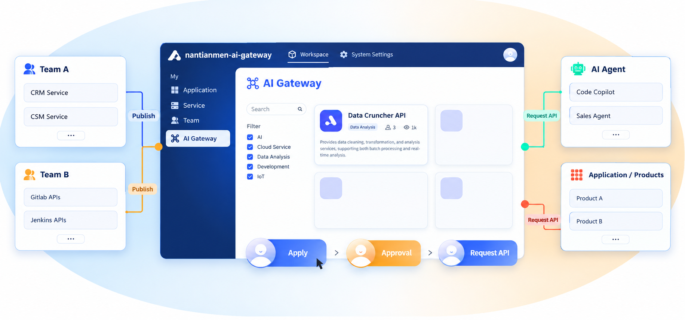
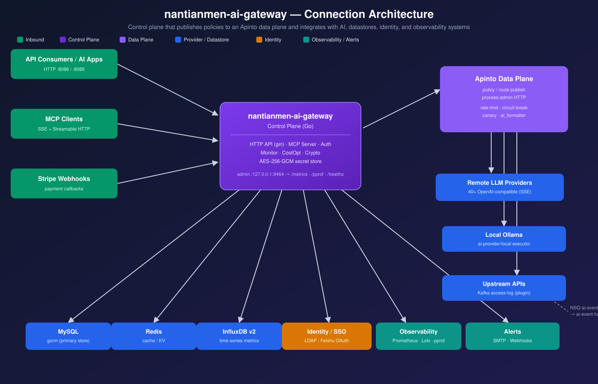

<p align="center">
  <a href="/README.md">English</a>
  | 
  <a href="/readme/readme-jp.md">日本語</a>
  | 
  <a href="/readme/readme-zh-cn.md">简体中文</a>
  | 
  <a href="/readme/readme-zh-tw.md">繁體中文</a>
</p>

<b>🦄 nantianmen-ai-gateway is an open-source, all-in-one AI gateway and API developer portal, helping developers and enterprises easily manage, integrate, and deploy AI services. nantianmen-ai-gateway is open-sourced under the Apache 2.0 license, which means it's free for commercial use!</b>

<br>

✨ With nantianmen-ai-gateway, you can:
1. Quickly connect to 100+ AI models, supporting all mainstream AI Companies!
2. Combine AI models and prompt templates into APIs, such as creating a sentiment analysis API, translation API, or data analysis API based on OpenAI GPT-4 and some custom prompts.
3. Standardize the data format of all AI API requests, so switching AI models or modifying prompts won’t affect your APP or microservices, simplifying your AI usage and maintenance costs.
4. Share APIs within the team through nantianmen-ai-gateway's developer portal.
5. Manage calling applications and API keys to ensure your API's security and stability.
6. Monitor your AI API usage with clear charts.
7. Quickly export API request logs to third-party logging platforms.

<br>

✨ nantianmen-ai-gateway is also a powerful cloud-native API gateway:
1. Built on a high-performance proxy engine, it supports cluster deployment and is designed for large-scale traffic. (Benchmark methodology and numbers are published in [readme/benchmark](./readme) — contributions welcome.)
2. Share REST APIs within the team, manage API call relationships, and prevent management costs and data breaches caused by chaotic API calls.


<br>

# 💌 Why Did We Build nantianmen-ai-gateway?
Before building nantianmen-ai-gateway, we spent seven years developing an API development and automated testing platform with over 1 million developer users, 500+ enterprise customers, and multi-million-dollar investment from Sequoia Capital.

As AI and Agents evolved, we noticed many enterprises wanted to integrate AI into both internal and third-party APIs, enabling AI agents to perform more complex tasks beyond being just knowledge-based Q&A bots. Hence, we built nantianmen-ai-gateway—your all-in-one AI gateway and API developer portal to accelerate your AI API development and quickly build your product or AI agent!

<br>

# ✨ Quick Start
nantianmen-ai-gateway is designed to solve the following problems:
- Seamlessly connect to various AI models and package these AI capabilities into APIs for easy calling, significantly reducing the barrier to using AI models.
- Manage complex AI & API call relationships.
- Manage API creation, monitoring, and security.
- Fault detection and troubleshooting: Simplifying system issue identification and resolution.
- Quantify data asset value: Enhance the visibility and valuation of data assets.

<br>

😍 Deploying nantianmen-ai-gateway is incredibly simple. With just one command line, you can deploy your AI gateway and API developer portal in under 5 minutes.

```
curl -sSO  https://download.nantianmen-ai-gateway.com/install/quick-start.sh ;  bash quick-start.sh
```

<br>

# 🔥 Features
<table>
  <tr>
    <th>
      Connect to 100+ AI models
    </th>
    <th>
      Unified API to use all AI
    </th>

  </tr>

  <tr>
    <td width="50%">
        
    </td>
    <td width="50%">
        
    </td>
  </tr>

  <tr>
    <th>
      Transform AI & Prompt to REST API
    </th>
    <th>
      API Developer Portal
    </th>

  </tr>

  <tr>
    <td width="50%">
        
    </td>
    <td width="50%">
        
    </td>
  </tr>

  <tr>
    <th>
      High Performance
    </th>
    <th>
      Manage API lifecycle
    </th>

  </tr>

  <tr>
    <td width="50%">
        
    </td>
    <td width="50%">
        
    </td>
  </tr>
  
  <tr>
    <th>
      Review subscription before allowing API requests
    </th>
    <th>
      Manage subscriber
    </th>
  </tr>

  <tr>
    <td width="50%">
            
    </td>
    <td width="50%">
        
    </td>
  </tr>

  <tr>
    <th>
      Logging
    </th>
    <th>
      Analysis
    </th>
  </tr>

  <tr>
    <td width="50%">
        
    </td>
    <td width="50%">
            
    </td>
  </tr>
  
</table>

<br>

<br>


# 🚀 Use Cases
## Simplify AI Integration Costs
  - Connect to 100+ major models from all mainstream AI vendors, with standardized API calls requiring no additional adaptation work.
  - Combine AI models and prompt templates to create new AI APIs, simplifying AI API development.
  - Quickly share AI APIs within the team.

## Enhance Operational Efficiency
  - Quickly build an internal API developer portal.
  - Efficiently manage and call APIs.
  - Reduce complex system call relationships.

## Ensure Compliance and Security
  - Powerful service governance and compliance management features.
  - Granular permission management for application calls.
  - Ensure API call security and compliance, reducing enterprise risk.

## Simplify System Troubleshooting
  - Use monitoring and diagnostic tools to quickly identify and resolve issues.
  - Reduce downtime and improve system stability.

## Multi-Tenant Management and Flexible Subscription
  - Supports multi-tenant management to meet different business unit needs.
  - Flexible subscription and approval processes simplify API usage and management.

## Improve API Observability
  - Real-time monitoring and tracking of API usage.
  - Fully understand data flow to enhance data usage transparency.

<br>

# 🏗 Architecture Notes

nantianmen-ai-gateway follows a layered design:



```
HTTP (gin + eosc autowire)
  └─ controller   # API layer: auth, parameter validation, response wrapping
      └─ module   # business orchestration: transactions, cross-service coordination
          └─ service  # domain logic (may only access this module's store)
              └─ stores  # data access (MySQL/Redis, uniformly wrapped)
```

Key runtime facts worth knowing before diving in:

- **Dependency injection**: based on `eolinker/go-common`'s `autowire`; struct fields are
  injected via the `autowired:""` tag — no constructor parameter passing.
- **Data-plane proxy**: request forwarding and policy execution (rate limiting `limiting`,
  circuit breaking `fuse`, canary `grey`, AI formatting `ai_formatter`, etc.) are driven by
  the apinto gateway on the data plane; the control plane (this repo) publishes policies/routes
  to the data plane.
- **LLM streaming**: SSE streaming responses from remote models are handled by the data-plane
  proxy; local (ollama) model pull progress is streamed via the executor pipeline in
  `ai-provider/local`.
- **Rate limiting**: implemented through the "policy → limiting driver → apinto limiting
  plugin" chain; it is an enterprise (`advanced_policy`) capability.
- **Sensitive config encryption**: `common/crypto` provides transparent AES-256-GCM encryption;
  the master key is `config.yml`'s `secret.encryption_key`.
- **Observability**: a dedicated admin port (default `127.0.0.1:9464`) exposes
  `/metrics` (Prometheus: request count/latency/inflight + Go runtime metrics),
  `/debug/pprof/*`, and `/healthz`; the address is configured via `config.yml`'s `metrics.addr`,
  set to `off` to disable.

<br>

# 🚩 Roadmap
We’ve set exciting goals for nantianmen-ai-gateway: enabling everyone to quickly create their own products and AI agents using AI and APIs!

To achieve this goal, we plan to add new features to nantianmen-ai-gateway, including:
1. Integrating with API marketplaces such as Postman, RapidAPI, APISpace, APILayer, etc. You can directly use APIs from various API marketplaces through nantianmen-ai-gateway and make them smarter using AI.
2. Integrating AI Agents such as Langchain, AgentGPT, Auto-GPT, Dify, and more, allowing AI Agents to access your internal or third-party APIs through nantianmen-ai-gateway to complete more complex tasks.
3. Intelligent API orchestration: nantianmen-ai-gateway will provide a unified API entry point and automatically orchestrate multiple APIs to fulfill your requests based on the API content.

<br>

# 📕 Documentation
Visit [nantianmen-ai-gateway Documentation](https://docs.nantianmen-ai-gateway.com/docs/deploy) for detailed installation guides, API references, and usage instructions.


# 🧑‍🤝‍🧑Friendly Links
<a href="https://xroute.ai/">
  

</a>
<br>

<br>

# 🧾 License
nantianmen-ai-gateway uses the Apache 2.0 License. For more details, please refer to the LICENSE file.


<br>

# 💌 Contact Us
For enterprise-level features and professional technical support, contact our pre-sales experts for personalized demos, customized solutions, and pricing.

- Website: https://nantianmen-ai-gateway.com
- Email: contact@nantianmen-ai-gateway.com

🙏 A big thanks to everyone who helped shape nantianmen-ai-gateway. We are thrilled to hear the community’s thoughts! Let’s make the world of APIs and AI stronger and more fun together. 🎉


<br>

# 🤝 Partner
- [Cursor](https://www.cursor.com/): Cursor is an AI-powered code editor that integrates artificial intelligence directly into the coding workflow, offering features like intelligent next edit suggestions, deep codebase understanding for relevant answers, and natural language editing to streamline development tasks and boost developer productivity.

- [Dify](https://dify.ai/): Dify is a leading Agentic AI Development Platform that provides a comprehensive suite of tools for building and extending AI applications, offering everything needed for agentic workflows, RAG pipelines, integrations, and observability, while allowing users to amplify their applications with various global Large Language Models (LLMs) and versatile plugins.

- [Trae](https://www.trae.ai/): Trae is an AI-native Integrated Development Environment (IDE) product that aims to embody the concept of “The Real AI Engineer” through intelligent productivity, seamlessly integrating into the development process to enhance quality and efficiency, featuring a chat-based interaction interface and supporting code generation and assistance.

- [Windsurf](https://windsurf.com/): Windsurf is an AI code editor designed to provide a seamless and limitless flow for developers, introducing a new purpose-built IDE that leverages AI to enhance coding with features like "Cascade" for deep codebase understanding, "Windsurf Tab" for intelligent autocompletion, and "Memories" for remembering important aspects of the codebase.

- [Coze](https://www.coze.com/): Coze is a next-generation AI application and chatbot development platform by ByteDance, empowering users to easily create and deploy powerful AI chatbots across various platforms with a no-code bot builder, integrated workflow logic, access to proprietary data, and simplified creation through pre-built plugins, knowledge bases, and workflows.

- [Claude Code](https://www.anthropic.com/claude-code): Claude Code is a command-line AI tool by Anthropic that embeds the Claude Opus 4 model directly into the user’s terminal, providing deep codebase awareness, the ability to edit files and execute commands, and making coordinated changes across multiple files, all while integrating seamlessly with popular IDEs and leveraging existing test suites.

- [Flowith](https://flowith.io/): Flowith is an AI creation workspace designed to revolutionize productivity and deep work by transforming knowledge and streamlining tasks through a multi-thread interface powered by advanced AI agents, offering an intuitive canvas-based user experience unlike traditional chat-based AI tools, and including a 24/7 operational version for complex tasks.

- [OpenManus](https://github.com/FoundationAgents/OpenManus): OpenManus is an open-source framework dedicated to building general AI agents, aiming to provide a platform where users can create and deploy their own agents without an invite code, supporting multi-agent capabilities, and requiring configuration for Large Language Model (LLM) APIs while integrating with browser automation tools.

- [Fellou](https://fellou.ai/): Fellou is an innovative Agentic Browser designed to transcend traditional web browsing by actively performing actions on behalf of the user, automating the entire process of information gathering and insight delivery, and excelling in in-depth research with seamless integrations with popular tools like Notion and LinkedIn.

- [Genspark](https://www.genspark.ai/): Genspark is an ultimate all-in-one AI companion offering a comprehensive suite of tools like AI Slides, AI Sheets, and AI Chat, designed to enhance various aspects of productivity and content creation, with personalized tools and AI Pods for generating content from diverse sources.

- [TEN](https://github.com/TEN-framework/ten-framework): TEN (The Embodied Narrator) is an open-source framework for building real-time, multimodal conversational voice AI agents, including components like TEN Framework, TEN Turn Detection, TEN Agent, TMAN Designer, and TEN Portal, offering features like Real-time Avatar, seamless MCP integration, real-time hardware communication, and vision/screenshare detection.

- [ChatGPT](https://chatgpt.com/): ChatGPT is an AI chatbot developed by OpenAI, built upon large language models like GPT-3.5 and GPT-4, designed to generate human-like conversational dialogue, understand context, answer follow-up questions, and integrate with various platforms for enhanced productivity through advanced language understanding, generation, and multilingual capabilities.

- [LangChain](https://www.langchain.com/): LangChain is a robust platform engineered for the development of reliable agents and Large Language Model (LLM) applications, offering a comprehensive product suite that seamlessly integrates various tools across the entire application development lifecycle, including LangGraph, LangSmith, and the LangGraph Platform, with functionalities for code generation, automation, and AI Search.

- [LEMON AI](https://lemonai.cc/): Lemon AI is the first Full-stack, Open-source, Agentic AI framework, offering a fully local alternative to platforms like Manus & Genspark AI. It features an integrated Code Interpreter VM sandbox for safe execution.

- [LobeChat](https://lobehub.com/): LobeHub offers LobeChat, a personal LLM productivity tool designed to elevate the user experience beyond traditional chatbots by empowering individuals to build personal AI agents and professional teams, supporting a wide array of LLMs, offering a simple chat interface, visual recognition, voice interaction, a rich plugin ecosystem, and knowledge base functionalities.

- [VS Code](https://code.visualstudio.com/): Visual Studio Code (VS Code) is a widely popular, free, and open-source code editor by Microsoft, renowned for its extensibility and customization, supporting vast programming languages, and integrating AI capabilities like intelligent next edit suggestions and an advanced “agent mode” for complex tasks, with broad compatibility with various AI models.

- [XRoute](https://xroute.ai): The Unified Interface For LLMs, provides better prices, better throughput, and no subscription.

- [XPack MCP Marketplace](https://github.com/xpack-ai/XPack-MCP-Marketplace): The world's first open-source MCP monetization platform, transform any OpenAPI into a monetizable MCP server and build your own API marketplace in just 10 minutes. Everything is open-source and ready for commercial use.

- [MemU](https://github.com/NevaMind-AI/memU): MemU is an open-source memory framework for AI companions
